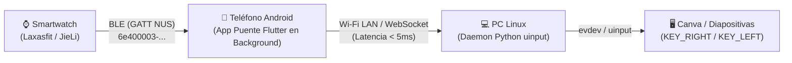

# Opción 2: App Clon Puente en Flutter / Android (Smartwatch BLE ➔ PC Remote)

Este documento detalla la arquitectura, el código fuente y las instrucciones paso a paso para construir una aplicación móvil dedicada en **Flutter (Android)** que actúe como puente permanente en segundo plano entre el Smartwatch (Laxasfit / HryFine / Chip JieLi) y la PC con Linux.

---

## 1. Arquitectura del Sistema



### Ventajas de la App en Android
1. **Conexión BLE 100% estable:** El stack Bluetooth de Android (`BluetoothGatt`) maneja los parámetros de supervisión y `Slave Latency` que el firmware del reloj espera, evitando las desconexiones que ocurren en Linux desktop.
2. **Segundo plano con pantalla apagada:** Con un `Foreground Service` de Android, el teléfono puede estar en tu bolsillo con la pantalla apagada durante toda una presentación de 2 horas sin interrumpir el enlace.
3. **Alcance total:** El reloj solo necesita estar cerca del teléfono (ambos van contigo), mientras que el teléfono se comunica con la PC a través del Wi-Fi del salón.

---

## 2. Estructura del Proyecto Flutter

Para crear el proyecto:
```bash
flutter create --org com.smartwatch smartwatch_bridge
cd smartwatch_bridge
```

### Dependencias necesarias (`pubspec.yaml`)
```yaml
dependencies:
  flutter:
    sdk: flutter
  flutter_blue_plus: ^1.34.0       # Stack BLE moderno y ultra estable para Android
  web_socket_channel: ^3.0.1      # Comunicación en tiempo real con la PC
  flutter_foreground_task: ^8.1.0 # Mantiene la app viva en segundo plano
  shared_preferences: ^2.3.0      # Guarda la IP de la PC y MAC del reloj
```

---

## 3. Permisos de Android (`android/app/src/main/AndroidManifest.xml`)

Agrega estos permisos dentro de `<manifest>`:
```xml
<!-- Permisos Bluetooth BLE -->
<uses-permission android:name="android.permission.BLUETOOTH" android:maxSdkVersion="30" />
<uses-permission android:name="android.permission.BLUETOOTH_ADMIN" android:maxSdkVersion="30" />
<uses-permission android:name="android.permission.BLUETOOTH_SCAN" android:usesPermissionFlags="neverForLocation" />
<uses-permission android:name="android.permission.BLUETOOTH_CONNECT" />
<uses-permission android:name="android.permission.ACCESS_FINE_LOCATION" android:maxSdkVersion="30" />

<!-- Red e Internet para hablar con la PC -->
<uses-permission android:name="android.permission.INTERNET" />
<uses-permission android:name="android.permission.ACCESS_NETWORK_STATE" />

<!-- Mantener vivo el servicio en el bolsillo -->
<uses-permission android:name="android.permission.FOREGROUND_SERVICE" />
<uses-permission android:name="android.permission.FOREGROUND_SERVICE_CONNECTED_DEVICE" />
<uses-permission android:name="android.permission.WAKE_LOCK" />
```

---

## 4. Lógica Principal en Dart (`lib/main.dart`)

```dart
import 'dart:async';
import 'dart:convert';
import 'package:flutter/material.dart';
import 'package:flutter_blue_plus/flutter_blue_plus.dart';
import 'package:web_socket_channel/web_socket_channel.dart';

// Constantes identificadas en la ingeniería inversa
const String TARGET_MAC = "41:42:2E:78:9B:68";
const String NUS_SERVICE_UUID = "6e400001-b5a3-f393-e0a9-e50e24dcca9f";
const String NUS_NOTIFY_CHAR_UUID = "6e400003-b5a3-f393-e0a9-e50e24dcca9f";

void main() => runApp(const SmartwatchBridgeApp());

class SmartwatchBridgeApp extends StatelessWidget {
  const SmartwatchBridgeApp({super.key});
  @override
  Widget build(BuildContext context) {
    return MaterialApp(
      title: 'Smartwatch Clicker Bridge',
      theme: ThemeData.dark(useMaterial3: true),
      home: const BridgeScreen(),
    );
  }
}

class BridgeScreen extends StatefulWidget {
  const BridgeScreen({super.key});
  @override
  State<BridgeScreen> createState() => _BridgeScreenState();
}

class _BridgeScreenState extends State<BridgeScreen> {
  final TextEditingController _ipController = TextEditingController(text: "10.0.0.3:8080");
  BluetoothDevice? _connectedDevice;
  WebSocketChannel? _wsChannel;
  bool _isBleConnected = false;
  bool _isWsConnected = false;
  String _statusLog = "Iniciando...";
  int? _lastSequence;

  @override
  void initState() {
    super.initState();
    _connectWebSocket();
    _connectToSmartwatch();
  }

  void _log(String msg) {
    setState(() => _statusLog = "$msg\n$_statusLog");
  }

  // 1. Conexión WebSocket a la PC
  void _connectWebSocket() {
    try {
      final wsUrl = Uri.parse("ws://${_ipController.text}/ws");
      _wsChannel = WebSocketChannel.connect(wsUrl);
      setState(() => _isWsConnected = true);
      _log("[✓] Conectado a la PC: ${wsUrl.host}");
    } catch (e) {
      setState(() => _isWsConnected = false);
      _log("[!] Error WebSocket con PC: $e");
    }
  }

  // 2. Conexión BLE con el Smartwatch
  Future<void> _connectToSmartwatch() async {
    _log("[+] Buscando reloj $TARGET_MAC...");
    
    // Escaneo selectivo
    FlutterBluePlus.startScan(timeout: const Duration(seconds: 10));
    FlutterBluePlus.scanResults.listen((results) async {
      for (ScanResult r in results) {
        if (r.device.remoteId.str.toUpperCase() == TARGET_MAC.toUpperCase()) {
          FlutterBluePlus.stopScan();
          _log("[✓] Reloj encontrado. Conectando...");
          _connectedDevice = r.device;
          
          await _connectedDevice!.connect(autoConnect: true);
          setState(() => _isBleConnected = true);
          _log("[✓] BLE Conectado al reloj");

          // Descubrimiento de servicios y suscripción a la cámara
          _subscribeToCameraShutter();
          break;
        }
      }
    });
  }

  Future<void> _subscribeToCameraShutter() async {
    if (_connectedDevice == null) return;
    List<BluetoothService> services = await _connectedDevice!.discoverServices();

    for (var s in services) {
      if (s.uuid.toString().toLowerCase() == NUS_SERVICE_UUID.toLowerCase()) {
        for (var c in s.characteristics) {
          if (c.uuid.toString().toLowerCase() == NUS_NOTIFY_CHAR_UUID.toLowerCase()) {
            await c.setNotifyValue(true);
            _log("[✓] Suscrito al disparador de cámara del reloj");

            c.onValueReceived.listen((List<int> bytes) {
              _processWatchBytes(bytes);
            });
          }
        }
      }
    }
  }

  // 3. Decodificación de paquetes Laxasfit / HryFine
  void _processWatchBytes(List<int> bytes) {
    if (bytes.length < 6) return;

    // Paquete Laxasfit: Header DF 00 06, Cmd 0x0C (Cámara), Subcmd 0x01 (Click)
    if (bytes[0] == 0xDF && bytes[4] == 0x0C && bytes[5] == 0x01) {
      int seq = bytes.length >= 7 ? bytes[6] : -1;

      // Desduplicación de ráfagas
      if (seq == _lastSequence) return;
      _lastSequence = seq;

      _log("🎯 Disparo detectado (Seq: $seq) ➜ Enviando a PC");

      // Transmitir evento a la PC vía WebSocket
      if (_wsChannel != null) {
        _wsChannel!.sink.add(jsonEncode({
          "event": "shutter",
          "sequence": seq,
          "timestamp": DateTime.now().millisecondsSinceEpoch
        }));
      }
    }
  }

  @override
  void dispose() {
    _wsChannel?.sink.close();
    _connectedDevice?.disconnect();
    super.dispose();
  }

  @override
  Widget build(BuildContext context) {
    return Scaffold(
      appBar: AppBar(title: const Text("Smartwatch Bridge")),
      body: Padding(
        padding: const EdgeInsets.all(16.0),
        child: Column(
          children: [
            Row(
              children: [
                Expanded(
                  child: TextField(
                    controller: _ipController,
                    decoration: const InputDecoration(labelText: "IP de la PC:Puerto"),
                  ),
                ),
                IconButton(
                  icon: const Icon(Icons.refresh),
                  onPressed: _connectWebSocket,
                ),
              ],
            ),
            const SizedBox(height: 16),
            Row(
              mainAxisAlignment: MainAxisAlignment.spaceAround,
              children: [
                Chip(
                  label: Text(_isBleConnected ? "⌚ Reloj: Conectado" : "⌚ Reloj: Desconectado"),
                  backgroundColor: _isBleConnected ? Colors.green.shade900 : Colors.red.shade900,
                ),
                Chip(
                  label: Text(_isWsConnected ? "💻 PC: Conectado" : "💻 PC: Desconectado"),
                  backgroundColor: _isWsConnected ? Colors.green.shade900 : Colors.red.shade900,
                ),
              ],
            ),
            const SizedBox(height: 16),
            Expanded(
              child: Container(
                padding: const EdgeInsets.all(8),
                color: Colors.black45,
                child: SingleChildScrollView(
                  child: Text(_statusLog, style: const TextStyle(fontFamily: 'monospace')),
                ),
              ),
            ),
          ],
        ),
      ),
    );
  }
}
```

---

## 5. Compilación e Instalación

Para compilar y cargar el APK a tu teléfono conectado por USB con depuración habilitada:
```bash
# 1. Compilar APK en modo Release
flutter build apk --release

# 2. Instalar directamente en el teléfono
adb install -r build/app/outputs/flutter-apk/app-release.apk
```

---

## 6. Lado PC (Servidor Receptor en Python)

El mismo servidor WebSocket que usamos para la Opción 1 (`web_bridge.py`) recibe las conexiones de esta app y ejecuta las pulsaciones de teclado en Linux con `evdev/uinput`.
